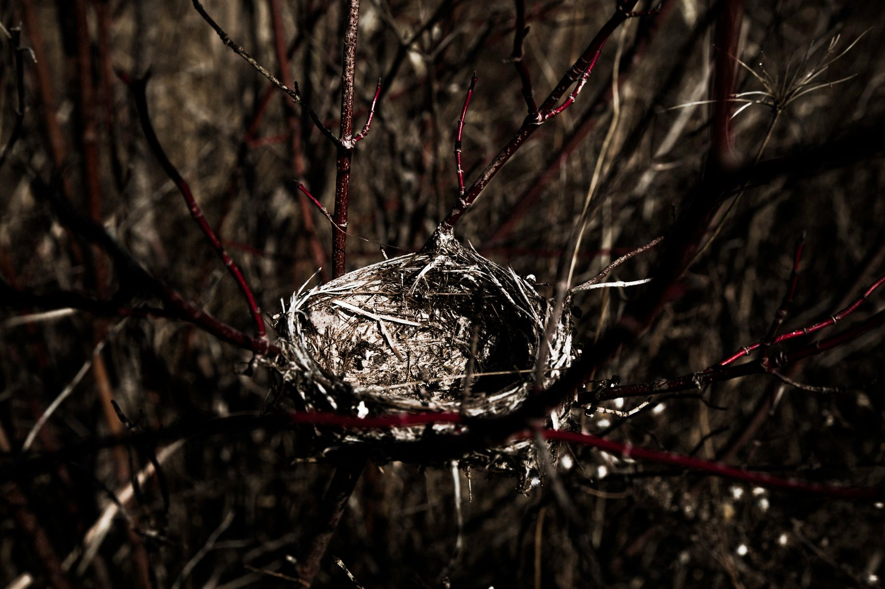

::: {.workshop-page}



```{=html}
<header class="workshop-hero">
  <div class="workshop-hero-copy">
    <p class="workshop-eyebrow">Fourth international conference</p>
    <h1>Null Objects<span>from a Crosslinguistic and Developmental Perspective</span><span class="workshop-hero-year">2027</span></h1>
    <p class="workshop-hero-date">21–22 October 2027<br>University of Vienna · Austria</p>
    <a class="workshop-button workshop-button-light" href="call-for-papers.html">Read the call for papers <span aria-hidden="true">→</span></a>
  </div>
  
</header>
<p class="workshop-image-credit">Photograph: <a href="https://www.pexels.com/photo/close-up-photography-of-bird-nest-907917/">Evelyn Chong</a> · <a href="https://www.pexels.com/license/">Pexels license</a>. Displayed cropped and in greyscale.</p>
```

:::: {.workshop-overview-grid}
::: {.workshop-intro}

## About the conference

Null Objects from a Crosslinguistic and Developmental Perspective 2027 will be hosted by the University of Vienna. It is the fourth edition, following conferences at University of Minho (2021), Goethe University, Frankfurt (2023), and [Palma, Mallorca (2025)](https://basla.uib.eu/activities/nocrodep2025/).

The conference serves as a platform for discussing current issues and insights into the study of null objects from a cross-linguistic and developmental perspective, irrespective of the underlying theoretical framework.

We welcome original, unpublished work for **20-minute talks, followed by 10 minutes of discussion, or posters**.

[Submission guidelines →](call-for-papers.qmd){.workshop-text-link}

:::
::: {.workshop-dates}

## Important dates

```{=html}
<dl>
  <div><dt>Submissions open</dt><dd>15 November 2026</dd></div>
  <div><dt>Submission deadline</dt><dd>31 March 2027</dd></div>
  <div><dt>Abstract review</dt><dd>1 April–1 May 2027</dd></div>
  <div><dt>Conference</dt><dd>21–22 October 2027</dd></div>
</dl>
```

:::
::::

## Invited speakers

```{=html}
<ul class="workshop-speakers">
  <li><h3>Marta Ruda</h3><p>Jagiellonian University</p></li>
  <li><h3>Pedro Guijarro-Fuentes</h3><p>Universitat de les Illes Balears</p></li>
  <li><h3>Vladimir Buskin</h3><p>KU Eichstätt</p></li>
</ul>
```

## Organizing committee

```{=html}
<ul class="workshop-organizers">
  <li>Albert Wall</li><li>Irene Fally</li><li>Marco Losavio</li><li>Philippa Adolf</li><li>Helena Vaz</li>
</ul>
```



:::
